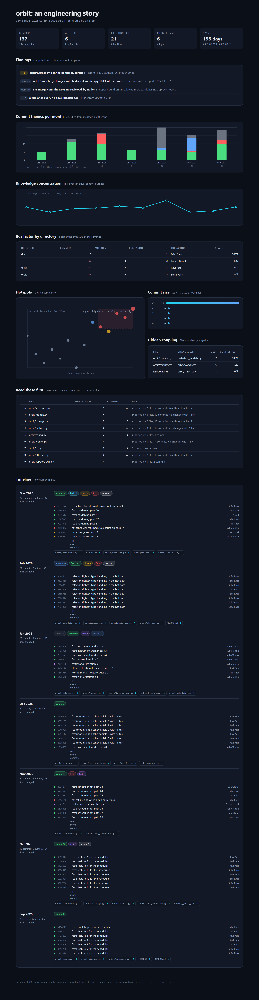
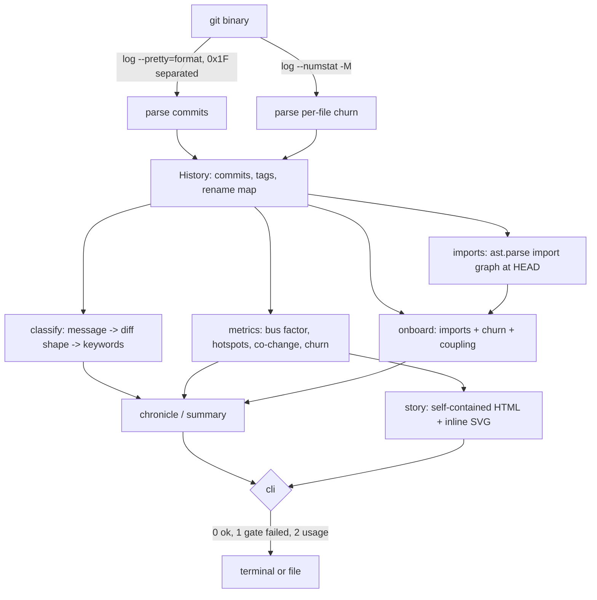

# git-story

**Turn a git history into an engineering narrative: what actually happened, who owns it, and where the risk is hiding.**




```bash
pip install -e .            # not on PyPI yet; source install
git-story summary           # one screen: findings, themes, cadence
git-story story --format html --out story.html
```

## The problem

Every repository contains an engineering story that no one wrote down. Which
directory dies if one person leaves? Which file absorbs half the commits while
nobody notices? Which two files are secretly married -- they always change
together, and the tests never say why? Dashboards answer "how many commits this
week". Nobody answers "what should I know before I touch this code".

git-story reads the history you already have and answers those questions with
numbers you can recompute yourself. No service, no token, no database, no
instrumentation: point it at a clone.

## What it does

* **Mines real history** through the `git` binary: commits, authors, per-file
  insertions/deletions after rename detection, merge graph, release tags.
* **Classifies every commit** into feature / fix / refactor / docs / test /
  build / release / chore, using the message first, the diff shape second and
  keywords last. `chronicle` turns that into a month-by-month narrative.
* **Bus factor per directory**: the fewest people who own 50% of a directory's
  commits, with a risk label and the top author's share.
* **Knowledge concentration over time** as a Herfindahl-Hirschman index over ten
  equal commit buckets, drawn as an inline SVG trend.
* **Hotspot quadrants**: churn x complexity, so "danger" means "changes all the
  time *and* is complex".
* **Co-change coupling**: file pairs ranked by confidence, support and lift; the
  high-confidence/low-support pairs are the hidden contracts.
* **Onboarding guide**: the ten files to read first, ranked from reverse imports
  (real `ast` parse), churn and co-change centrality -- with the evidence shown
  next to every row.
* **A self-contained HTML story page** with inline SVG charts, findings, bus
  factor, hotspots, coupling and a full timeline. One file, no CDN, no scripts.
* **Machine-readable output**: `--json` on every command, plus `--fail-on` quality
  gates for CI (`bus-factor`, `hotspot`, `unreviewed`).
* **Pure stdlib**: zero runtime dependencies. Python 3.10+, git 2.20+.

## Install

Not on PyPI yet -- install from source:

```bash
git clone https://github.com/kele-tao/git-story
cd git-story
python -m pip install -e .
git-story --version
```

Requirements: Python 3.10+ and a `git` binary on `PATH`. There are no runtime
dependencies; `pip install -e ".[dev]"` adds pytest and ruff for development.

## Usage

### 1. The one-screen overview

```
$ git-story summary examples/demo_repo
demo_repo  engineering history
137 commits | 6 authors | 4 tags | 2025-09-19 to 2026-03-31

Findings
  ! orbit/worker.py is in the danger quadrant
    14 commits by 3 authors, 96 lines churned
  ! orbit/models.py changes with tests/test_models.py 100% of the time
    7 shared commits, support 5.1%, lift 0.37
  ! 3/6 merge commits carry no reviewed-by trailer
    an upper bound on unreviewed merges; git has no approval record
  ! a tag lands every 41 days (median gap)
    4 tags from v0.2.0 to v1.0.1

Theme mix
+----------+---------+-------+--------------------------+
| theme    | commits | share |                          |
+----------+---------+-------+--------------------------+
| feature  |      76 |   55% | ######################## |
| fix      |      14 |   10% | ####.................... |
| refactor |      14 |   10% | ####.................... |
| chore    |      12 |    9% | ####.................... |
| test     |       9 |    7% | ###..................... |
| docs     |       5 |    4% | ##...................... |
| build    |       4 |    3% | #....................... |
| release  |       3 |    2% | #....................... |
+----------+---------+-------+--------------------------+

Commit size
  XS:136  S:0  M:1  L:0  XL:0   (lines changed per commit: XS<10 ... XL>=1000)
```

(The real command prints box-drawing characters and colour; this snippet is
plain-text for readability. Run it to see the actual output.)

### 2. The narrative chronicle

```
$ git-story chronicle examples/demo_repo --since 1y --per-month 2
demo_repo  engineering history
92 commits | 6 authors | 4 tags | 2025-11-24 to 2026-03-31

Mar 2026  27 commits  ##################·  6 authors  +141/-6
           Feature  14  Build     4  Docs      4  Fix       4  Release   1
          4d422ee  Fix      fix: scheduler returned stale count on pass 9
          448d9e3  Feature  feat: hardening pass 50
          ... 25 more

Feb 2026  22 commits  ##############····  5 authors  +81/-14
           Refactor 12  Feature   7  Docs      1  Fix       1  Release   1
```

`--since` accepts `1y`, `6m`, `2w`, `30d` or an ISO date. `--until` is the
upper bound.

### 3. The generated story page

```
$ git-story story examples/demo_repo --format html --out docs/story.html
git-story: wrote docs/story.html (35,023 bytes)
```

Open `docs/story.html` in any browser. It is a single file with inline SVG
charts and no external requests. The screenshot at the top of this README is
that exact page, rendered.

### 4. The developer-facing analyses

```
$ git-story bus-factor examples/demo_repo
Bus factor by directory  (fewest people owning 50% of the commits)

+-----------+---------+---------+-----+-------------+-------+------+
| directory | commits | authors | bus | top author  | share | risk |
+-----------+---------+---------+-----+-------------+-------+------+
| docs      |       1 |       1 |   1 | Mia Chen    |  100% | low  |
| .         |      11 |       3 |   2 | Tomas Novak |   45% | high |
| tests     |      17 |       4 |   2 | Ravi Patel  |   41% | high |
| orbit     |     113 |       6 |   3 | Sofia Rossi |   25% | ok   |
+-----------+---------+---------+-----+-------------+-------+------+

No directory is owned by a single person.

$ git-story onboard examples/demo_repo
Read these first  (reverse imports + churn + co-change centrality)

+----+------------------------+-------------+---------+---------+------------------+
| #  | file                   | imported by | commits | authors | why              |
+----+------------------------+-------------+---------+---------+------------------+
| 1. | orbit/scheduler.py     |           7 |      50 |       6 | imported by 7... |
| 2. | orbit/models.py        |           6 |      19 |       3 | imported by 6... |
| 3. | orbit/storage.py       |           7 |      13 |       3 | imported by 7... |
+----+------------------------+-------------+---------+---------+------------------+

$ git-story hotspots --top 3
$ git-story coupling --min-together 3
$ git-story refactor
```

### 5. JSON and CI gates

```
$ git-story hotspots --json | head -20
{
  "repo": "git-story",
  "root": "/path/to/git-story",
  "commits": 2,
  ...
}

$ git-story bus-factor --fail-on bus-factor
git-story: quality gate failed: bus factor 1 in src
$ echo $?
1
```

Exit codes are documented and stable: **0** success, **1** a `--fail-on` quality
gate tripped, **2** usage error (bad flag, not a repository, unparsable
`--since`). User errors never print a traceback.

## How it works



The pipeline is deliberately boring: git is the only input, everything after the
parse is a pure function over an in-memory `History`. That is why the tests build
real repositories in temp directories instead of mocking, and why the output is
byte-identical between runs.

Two details are worth calling out. First, **renames are canonicalised**: git
reports `old => new`, and without rewriting historical paths every analysis
inherits a phantom directory (`support}`) that no longer exists. `History` builds a
rename map, follows chains, and rewrites every `FileChange` to the newest name
while preserving churn. Second, **the classifier is ordered**: an explicit
`refactor:` prefix always beats the diff shape, so a rename-heavy commit that the
author called a feature is not silently reclassified.

The HTML page is generated from the same numbers the terminal prints, as inline
SVG -- so the page and the CLI can never disagree, and the page has no scripts,
fonts or network requests to break in five years.

## Design decisions

1. **Shell out to git, never re-implement it.** libgit2 bindings would be faster
   and would also mean native wheels, platform bugs and a dependency. `git log
   --numstat -M` is the ground truth for churn-after-rename, and every developer
   already has git installed. The cost is a subprocess per read; the benchmark
   below shows that cost is a few hundred milliseconds even at 3000 commits.

2. **Pure stdlib, including the charts.** A dependency-free tool runs in a
   locked-down CI container and in a colleague's laptop with a stale venv. The
   price is writing our own table renderer and SVG generator; the reward is that
   `pip install -e .` cannot fail.

3. **Heuristics must print their evidence and their limits.** The hotspot
   "complexity" axis is a documented proxy, not cyclomatic complexity. The
   review-less merge count is an upper bound because git has no approval record.
   The onboarding ranking prints importers/commits/co-change partners next to
   each row. A number without its method is a lie with a decimal point;
   `docs/method.md` documents every formula.

## Performance

Measured by `python benchmarks/run.py` on synthetic repositories (6 authors, 60
modules, one paired-file commit every seven commits). Full table in
`docs/benchmark.md`, raw JSON in `benchmarks/results.json`.

| commits | scan | analyses | HTML | total | HTML size |
| ---: | ---: | ---: | ---: | ---: | ---: |
| 200 | 663 ms | 50 ms | 86 ms | **0.80 s** | 21 KB |
| 1,000 | 552 ms | 256 ms | 245 ms | **1.08 s** | 24 KB |
| 3,000 | 586 ms | 815 ms | 540 ms | **2.02 s** | 32 KB |

3000 commits, every analysis and a full HTML page in about two seconds, with
`scan` (the `git log` subprocess) as the floor. Co-change is capped at 30 files
per commit so a single release commit cannot make it quadratic.

## Comparison

| Tool | What it does better | Where git-story differs |
| --- | --- | --- |
| `git log` / `git shortlog` | Instant, exact, zero install | No aggregation: you get raw history, not ownership, hotspots or coupling |
| CodeScene | Deep behavioural-code analysis, per-language complexity, hosted UI | git-story is offline, dependency-free, and never uploads your code; CodeScene's complexity model is far more precise than our documented proxy |
| `git-of-theseus`, `hercules` | Rich cohort and burndown analysis, longer track record | git-story focuses on the decisions a team makes this sprint: who owns what, what to read first, what changes together, and it emits a shareable page |
| GitHub Insights | Zero setup on GitHub, PR-level review data | Works on any clone, including private and offline repositories, and is honest that it cannot see review approvals (git has no such record) |

## Roadmap

Short version (`docs/ROADMAP.md` has the reasoning):

* Optional hosted-forge review data behind an explicit `--github` flag.
* Per-language complexity adapters when available, preserving the proxy fallback.
* `.mailmap`-aware author identity and a warning for duplicate identities.
* `--blame` ownership weighted by surviving lines.
* An optional interactive filter for the HTML page.

## Contributing

Issues and pull requests are welcome. Read `CONTRIBUTING.md` first: the two
rules are that every number must be reproducible and the tool must work on any
repository. Run `python -m pytest -q` and `python -m ruff check .` before
opening a PR; CI runs both on Python 3.10, 3.11 and 3.12. The suite is 138 tests
with 93% line coverage of `src/gitstory` (measured with `pytest --cov=gitstory`).

## License

MIT (c) 2026 kele. See `LICENSE`.
