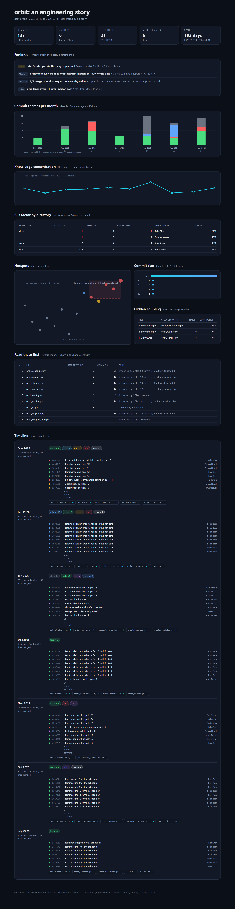
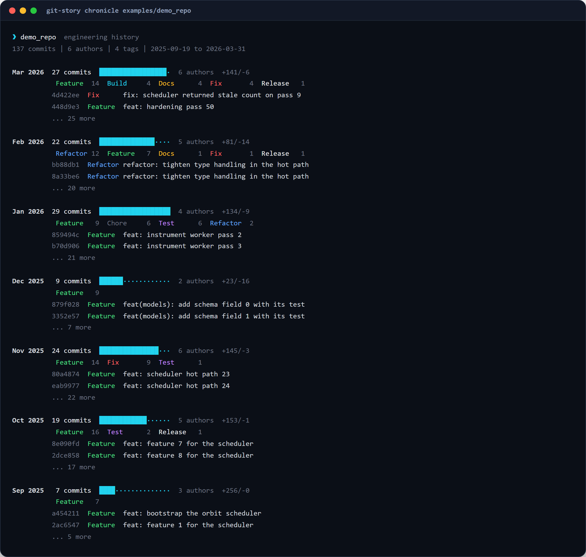
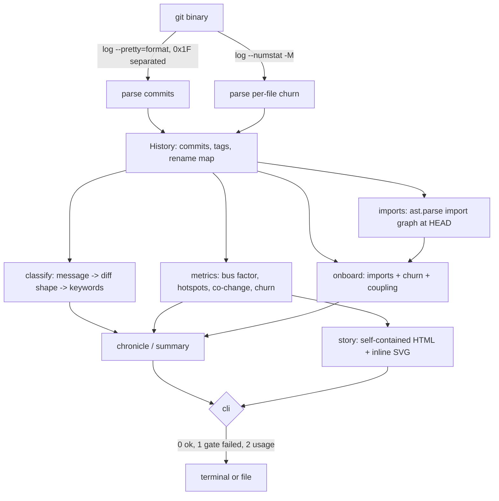

# git-story

[English](README.md) | **简体中文**

**把一段 git 历史读成一份工程叙事：究竟发生了什么、谁在负责、风险又藏在哪里。**




```bash
pip install -e .            # not on PyPI yet; source install
git-story summary           # one screen: findings, themes, cadence
git-story story --format html --out story.html
```

## 问题

每个仓库里都埋着一个没人写下来的工程故事。哪个目录只要走掉一个人就会瘫痪？
哪个文件悄悄吞掉了半数提交，而周围没人察觉？哪两个文件私底下结了婚——它们
永远一起改动，而测试从不解释原因？仪表盘回答的是「这周提交了多少次」，
却没人回答「在动这段代码之前，我该先知道什么」。

git-story 读取你手上已有的历史，用你自己就能复算的数字来回答这些问题。
不需要服务、不需要 token、不需要数据库、不需要埋点：把它指向一份 clone 就行。

## 它能做什么

* **挖掘真实历史**：通过 `git` 二进制读取提交、作者、重命名检测之后逐文件的
  增删行数、合并图与发布标签。
* **给每次提交归类**：feature / fix / refactor / docs / test / build / release / chore。
  判定顺序是先看提交信息，再看 diff 形态，最后才看关键词。`chronicle` 会把
  分类结果变成逐月的叙事。
* **按目录统计巴士系数**：占满一个目录 50% 提交所需的最少人数，并给出风险
  标签和第一作者的占比。
* **知识集中度随时间的变化**：把提交等分成十段，用赫芬达尔－赫希曼指数
  （Herfindahl-Hirschman index）衡量，并以内联 SVG 趋势图画出。
* **热点象限**：变更频次 × 复杂度，因此「危险」意味着「一直在改，而且很复杂」。
* **共同变更耦合**：文件对按置信度、支持度与提升度排名；那些高置信度、
  低支持度的组合，正是隐藏的契约。
* **上手指南**：最该先读的十个文件，排序依据是反向导入（真正的 `ast` 解析）、
  变更频次和共同变更中心性——每一行旁边都摆着证据。
* **一份自包含的 HTML 叙事页面**：内联 SVG 图表、发现项、巴士系数、热点、
  耦合关系和完整时间线。单个文件，不依赖 CDN，不含脚本。
* **机器可读的输出**：每条命令都支持 `--json`，另有供 CI 使用的 `--fail-on`
  质量门禁（`bus-factor`、`hotspot`、`unreviewed`）。
* **纯标准库**：零运行时依赖。Python 3.10+，git 2.20+。

## 安装

尚未发布到 PyPI——请从源码安装：

```bash
git clone https://github.com/kele-tao/git-story
cd git-story
python -m pip install -e .
git-story --version
```

环境要求：Python 3.10+，以及 `PATH` 上可用的 `git` 二进制。运行时没有依赖；
`pip install -e ".[dev]"` 会为开发额外装上 pytest 和 ruff。

## 用法

下面的示例使用 `examples/demo_repo`。这个演示仓库是**现场生成、而不是提交进
仓库的**（在一个 git 仓库里再塞一个 git 仓库是个坑）。先生成一次：

```bash
python benchmarks/make_demo_repo.py     # 137 commits, 6 authors, 4 tags
```

每条命令也能用在你自己的仓库上：省略路径参数，git-story 就分析当前目录。

### 1. 一屏总览

```
$ git-story summary examples/demo_repo
demo_repo  engineering history
137 commits | 6 authors | 4 tags | 2025-09-19 to 2026-03-31

Findings
  ! orbit/worker.py is in the danger quadrant
    14 commits by 3 authors, 96 lines churned
  ! orbit/models.py changes with tests/test_models.py 100% of the time
    7 shared commits, support 5.1%, lift 0.37
  ! 3/6 merge commits carry no reviewed-by trailer
    an upper bound on unreviewed merges; git has no approval record
  ! a tag lands every 41 days (median gap)
    4 tags from v0.2.0 to v1.0.1

Theme mix
+----------+---------+-------+--------------------------+
| theme    | commits | share |                          |
+----------+---------+-------+--------------------------+
| feature  |      76 |   55% | ######################## |
| fix      |      14 |   10% | ####.................... |
| refactor |      14 |   10% | ####.................... |
| chore    |      12 |    9% | ####.................... |
| test     |       9 |    7% | ###..................... |
| docs     |       5 |    4% | ##...................... |
| build    |       4 |    3% | #....................... |
| release  |       3 |    2% | #....................... |
+----------+---------+-------+--------------------------+

Commit size
  XS:136  S:0  M:1  L:0  XL:0   (lines changed per commit: XS<10 ... XL>=1000)
```

（真实命令会打印制表框线和颜色，这一段为了易读换成了纯文本。想看实际输出
就自己跑一遍。）

### 2. 逐月编年史



下图是下面这条命令在真实终端里的渲染结果：

```bash
git-story chronicle examples/demo_repo --per-month 2
```

`--since` 接受 `1y`、`6m`、`2w`、`30d` 或一个 ISO 日期；`--until` 是上界。
每个月都会得到一条提交量条、主题构成，以及最早的 `--per-month` 条提交，
于是一年的历史刚好压进一屏。

### 3. 生成的叙事页面

```
$ git-story story examples/demo_repo --format html --out docs/story.html
git-story: wrote docs/story.html (35,023 bytes)
```

用任意浏览器打开 `docs/story.html`。它是一个单文件，图表是内联 SVG，
不发起任何外部请求。本 README 顶部那张截图，就是这个页面渲染出来的样子。

### 4. 面向开发者的分析

```
$ git-story bus-factor examples/demo_repo
Bus factor by directory  (fewest people owning 50% of the commits)

+-----------+---------+---------+-----+-------------+-------+------+
| directory | commits | authors | bus | top author  | share | risk |
+-----------+---------+---------+-----+-------------+-------+------+
| docs      |       1 |       1 |   1 | Mia Chen    |  100% | low  |
| .         |      11 |       3 |   2 | Tomas Novak |   45% | high |
| tests     |      17 |       4 |   2 | Ravi Patel  |   41% | high |
| orbit     |     113 |       6 |   3 | Sofia Rossi |   25% | ok   |
+-----------+---------+---------+-----+-------------+-------+------+

No directory is owned by a single person.

$ git-story onboard examples/demo_repo
Read these first  (reverse imports + churn + co-change centrality)

+----+------------------------+-------------+---------+---------+------------------+
| #  | file                   | imported by | commits | authors | why              |
+----+------------------------+-------------+---------+---------+------------------+
| 1. | orbit/scheduler.py     |           7 |      50 |       6 | imported by 7... |
| 2. | orbit/models.py        |           6 |      19 |       3 | imported by 6... |
| 3. | orbit/storage.py       |           7 |      13 |       3 | imported by 7... |
+----+------------------------+-------------+---------+---------+------------------+

$ git-story hotspots --top 3
$ git-story coupling --min-together 3
$ git-story refactor
```

### 5. JSON 输出与 CI 门禁

```
$ git-story hotspots --json | head -20
{
  "repo": "git-story",
  "root": "/path/to/git-story",
  "commits": 2,
  ...
}

$ git-story bus-factor --fail-on bus-factor
git-story: quality gate failed: bus factor 1 in src
$ echo $?
1
```

退出码有文档、且保持稳定：**0** 表示成功，**1** 表示触发了 `--fail-on`
质量门禁，**2** 表示用法错误（参数不对、不是仓库、`--since` 无法解析）。
用户错误永远不会打印 traceback。

## 自测：用 git-story 分析 git-story

CI 里会让这个工具跑它自己的仓库，下面是它对自己的评价（在新 clone 里执行
`git-story bus-factor` 就能复现）：

```
$ git-story bus-factor
git-story  engineering history
16 commits | 1 authors | 0 tags | 2026-10-16 to 2026-11-13

Bus factor by directory  (fewest people owning 50% of the commits)

+------------+---------+---------+-----+------------+-------+----------+
| directory  | commits | authors | bus | top author | share | risk     |
+------------+---------+---------+-----+------------+-------+----------+
| src        |      10 |       1 |   1 | kele       |  100% | critical |
| benchmarks |       3 |       1 |   1 | kele       |  100% | low      |
| docs       |       2 |       1 |   1 | kele       |  100% | low      |
+------------+---------+---------+-----+------------+-------+----------+

!! 1 directory would be orphaned if one person left.
```

一个人的项目，巴士系数就是一。这个工具不会替自己的仓库说好话，而这正是
重点：数字来自 `git log` 的计算，不是来自一枚徽章。

## 工作原理



这条流水线刻意做得很无聊：git 是唯一输入，解析之后的一切都是对内存中
`History` 对象的纯函数。所以测试会在临时目录里搭出真实的仓库、而不是用
mock；所以输出在多次运行之间保持字节级一致。

有两个细节值得单独说明。第一，**重命名会被归一化**：git 报出的是
`old => new`，如果不重写历史路径，所有分析都会继承一个早已不存在的幽灵
目录（`support}`）。`History` 会建立重命名映射、沿着链条一路追下去，把每个
`FileChange` 改写到最新的名字上，同时保留变更量。第二，**分类器是有优先级
的**：显式的 `refactor:` 前缀永远压过 diff 形态，因此一次以重命名为主、
作者嘴上却说是 feature 的提交，不会被悄悄改判。

HTML 页面是用终端打印的同一批数字生成的，图表为内联 SVG——所以页面和 CLI
不可能互相矛盾；页面里没有脚本、没有字体、没有网络请求，五年后也不会坏掉。

## 设计取舍

1. **调用 git 二进制，绝不重新实现它。** 用 libgit2 绑定会更快，但同时也意味着
   原生 wheel、平台 bug 和一个依赖。`git log --numstat -M` 是「重命名之后变更
   量」的标准答案，而每个开发者本来就装了 git。代价是每次读取都要起一个
   子进程；下面的基准测试表明，即便在 3000 次提交的规模上，这个代价也只有
   几百毫秒。

2. **连图表在内，全部只用标准库。** 零依赖的工具能跑在被锁死的 CI 容器里，
   也能跑在同事那台 venv 早已过期的笔记本上。代价是要自己写表格渲染器和
   SVG 生成器；回报是 `pip install -e .` 不会失败。

3. **启发式必须同时打印证据和边界。** 热点里的「复杂度」轴是有文档说明的
   代理指标，不是圈复杂度。无评审合并的数量只是个上界，因为 git 里没有
   审批记录。上手指南会在每一行旁边打印导入者、提交数和共同变更伙伴。
   没有方法的数字只是带小数点的谎言；`docs/method.md` 记录了每一个公式。

## 性能

由 `python benchmarks/run.py` 在合成仓库上测得（6 位作者、60 个模块，
每七次提交里有一次成对文件的提交）。完整表格见 `docs/benchmark.md`，
原始 JSON 在 `benchmarks/results.json`。

| 提交数 | scan | analyses | HTML | total | HTML 大小 |
| ---: | ---: | ---: | ---: | ---: | ---: |
| 200 | 663 ms | 50 ms | 86 ms | **0.80 s** | 21 KB |
| 1,000 | 552 ms | 256 ms | 245 ms | **1.08 s** | 24 KB |
| 3,000 | 586 ms | 815 ms | 540 ms | **2.02 s** | 32 KB |

3000 次提交，跑完全部分析并生成完整的 HTML 页面大约两秒，其中 `scan`
（即 `git log` 子进程）是地板价。共同变更分析把每次提交涉及的文件数限制在
30 个以内，这样单次发布提交不会把它拖成平方级。

## 对比

| 工具 | 它做得更好的地方 | git-story 的差异 |
| --- | --- | --- |
| `git log` / `git shortlog` | 瞬时、精确、零安装 | 不做聚合：你拿到的是原始历史，不是归属、热点或耦合 |
| CodeScene | 深入的行为代码分析、按语言的复杂度、托管界面 | git-story 离线、零依赖、从不上传你的代码；CodeScene 的复杂度模型远比我们那个有文档的代理指标精确 |
| `git-of-theseus`、`hercules` | 丰富的队列分析与燃尽分析，更长的项目履历 | git-story 关注团队这周就要做的决定：谁负责什么、先读什么、什么总一起变，并且能产出一张可分享的页面 |
| GitHub Insights | 在 GitHub 上零配置，有 PR 级别的评审数据 | 能跑在任何 clone 上，包括私有和离线仓库；并且诚实承认它看不到评审批准（git 里没有这种记录） |

## 路线图

简版如下（理由写在 `docs/ROADMAP.md` 里）：

* 通过显式的 `--github` 开关，可选接入托管平台的评审数据。
* 在条件允许时接入按语言的复杂度适配器，同时保留代理指标作为兜底。
* 识别 `.mailmap` 的作者身份，并对重复身份给出警告。
* 用 `--blame` 按存活代码行数加权计算归属。
* 为 HTML 页面提供可选的交互式筛选。

## 参与贡献

欢迎提 issue 和 pull request。请先读 `CONTRIBUTING.md`：两条规矩是每个数字都
必须可复现、工具必须在任何仓库上都能用。开 PR 之前先跑
`python -m pytest -q` 和 `python -m ruff check .`；CI 在 Python 3.10、3.11
和 3.12 上都会跑这两条。测试套件共 138 个测试，对 `src/gitstory` 的行覆盖率为
93%（用 `pytest --cov=gitstory` 测得）。

## 许可证

MIT (c) 2026 kele。详见 `LICENSE`。